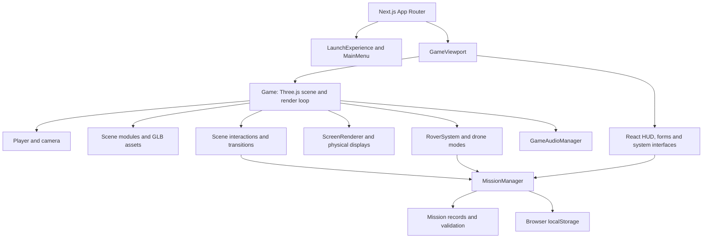

<p align="center">
  
</p>

<h1 align="center">PHOBOSIA</h1>

<p align="center">A browser-based, first-person 3D exploration and scientific-observation experience set at a fictional Mars outpost.</p>

<p align="center">
  <a href="https://phobosia.sim623.site/">Play PHOBOSIA</a> ·
  <a href="http://infophobosia.sim623.site/">Project portfolio</a>
</p>

PHOBOSIA is an independent interactive experience about exploring and operating a fictional Martian outpost. Players move through connected habitat, engineering, science, mission-control and airlock areas, investigate existing interfaces and follow a structured SOL 1–11 campaign. Activities include target selection, a simulated drone survey, a ground-level field investigation, outpost-system assessments and a final expedition handover and departure.

PHOBOSIA is not a survival game, a scientific instrument, an official NASA mission or a NASA-endorsed product. Mission records and simulated readings are part of the experience; they are not validated scientific findings or live Mars telemetry.

## Contents

- [Play and project links](#play-and-project-links)
- [Experience overview](#experience-overview)
- [SOL 1 to 11 campaign](#sol-1-to-11-campaign)
- [Gameplay and systems](#gameplay-and-systems)
- [Controls](#controls)
- [Technology](#technology)
- [Architecture](#architecture)
- [3D model inventory](#3d-model-inventory)
- [Mars terrain and scientific-data transparency](#mars-terrain-and-scientific-data-transparency)
- [Asset attribution](#asset-attribution)
- [Run locally](#run-locally)
- [Project structure](#project-structure)

## Play and project links

| Resource | What it is |
|---|---|
| [Playable experience](https://phobosia.sim623.site/) | The browser game. |
| [Project portfolio](http://infophobosia.sim623.site/) | The project presentation and further background. |

## Experience overview

The application runs in a modern browser and renders its interactive environment with Three.js and WebGL. It combines a first-person player controller, connected 3D modules, physical in-world interaction points, mission state and report workflows, custom-rendered console screens, a HUD, audio and video.

The playable environment includes the Habitat, Central Hub and connectors, Engineering Unit, Science Lab, Mission Control, Airlock, Drone Section and outdoor Mars terrain. The mission system connects those areas to a campaign that develops from outpost orientation and readiness into target selection, investigation and operational handover.

The experience is designed around exploration, observation, evidence, uncertainty and systems operations. It does not claim that player-created records are scientific observations made on Mars.

## SOL 1 to 11 campaign

The active campaign definitions are in `src/core/MissionManager.ts`, `src/core/Day1Config.ts`, `src/missions/`, and `src/jsons/Missions/sol-02.json` through `sol-11.json`. SOL 1 is defined in the Day 1 configuration and runtime mission definitions; it does not have a matching `sol-01.json` file. The lists below preserve the configured task order and names.

### SOL 1 — Outpost Orientation

Explore the outpost, inspect required systems and consoles, and complete the 20-task orientation checklist. The configured activities cover the Habitat, Engineering Unit, Science Lab, Mission Control, Airlock and Drone Section. Completing the rest-area orientation task introduces the existing rest interaction; it does not itself advance the mission day.

1. Inspect Habitat Status
2. Review Water and Nutrition
3. Use the Habitat Workstation
4. Locate the Crew Rest Area
5. Inspect Engineering Monitoring
6. Inspect Power Systems
7. Inspect Engineering Life Support
8. Inspect Diagnostics
9. Inspect Engineering Storage
10. Inspect Research Monitoring
11. Inspect Research Analysis
12. Review Seed Inventory
13. Review Water and Nutrient Preparation
14. Inspect Water Quality
15. Inspect Cultivation Environment
16. Review Mission Objectives
17. Review Communications and Systems
18. Review Terrain and Reconnaissance Systems
19. Inspect Airlock Controls
20. Drone Section

**Progression:** The orientation checklist must be completed before the existing Habitat rest interaction advances the campaign.

### SOL 2 — Outpost Readiness

Inspect Habitat and Engineering information through the configured physical consoles. Record findings and limitations, then submit an evidence-supported readiness assessment. The mission distinguishes player assessment from verified system diagnosis.

1. Review Habitat Status, Life Support, and Emergency Information — Habitat main monitor views.
2. Inspect Water and Nutrition Systems — Habitat water and nutrition interface.
3. Inspect Engineering Monitoring — Engineering monitoring displays.
4. Investigate the Power Unit — Engineering power unit.
5. Inspect Engineering Life Support — Engineering life-support displays.
6. Review Engineering Diagnostics — Engineering diagnostics workbench.
7. Submit Outpost Readiness Assessment — submit the record at the configured readiness interface.

**Output and completion:** Six investigation records and a readiness assessment with evidence references and player comments are required. The configured readiness report supports an `insufficient evidence` assessment when the available records do not justify a stronger conclusion.

### SOL 3 — Scientific Target Selection

Review mission context and operational constraints, compare the three in-game target profiles, select a proposed observation site and evaluate the available training metadata. The target becomes official only after a validated proposal is submitted.

1. Review Mission Objectives and Outpost Status
2. Explore Mars Observation Sites
3. Review Communications and Operational Constraints
4. Select a Proposed Scientific Target
5. Investigate and Select a Scientific Dataset
6. Submit the Scientific Observation Proposal

The three configured target profiles are Site Alpha — North Crater Rim Ridge, Site Beta — Dune Basin Depression and Site Gamma — Canyon Overlook Escarpment. The configured dataset identifier is `PHOBOSIA_TARGET_PROFILE_TRAINING`; it is training metadata, not a verified external planetary dataset.

**Output and completion:** Submit a proposal that references the selected target, available dataset metadata, supporting records and limitations. Successful validation records the official target for later missions.

### SOL 4 — Selected Target Investigation and Drone Mission Preparation

Investigate the SOL 3 target using available Mission Control and Science Lab records. Visit the Drone Section in person, inspect the existing drone and prepare its SOL 5 observation plan. SOL 4 is a preparation mission; it does not launch the aerial flight.

1. Review Sol 4 Mission Objectives
2. Investigate the Selected Observation Target
3. Review Terrain and Scientific Dataset Evidence
4. Visit and Inspect the Drone
5. Prepare the Sol 5 Drone Observation Plan
6. Submit the Preliminary Terrain Assessment and Mission Preparation Report

**Output and completion:** The preparation report is expected to reference the target investigation, terrain-data limitations, physical drone inspection and flight-plan records.

### SOL 5 — Aerial Reconnaissance

Manually fly the existing drone simulation to the official SOL 3 target, inspect the target area, review target-specific prepared evidence, return to the designated landing area and submit a reconnaissance report.

1. Complete Drone Flight Operations Briefing
2. Activate Drone Reconnaissance Simulation
3. Inspect the Officially Selected Target
4. Return and Safely Land the Drone
5. Review Target-Specific Evidence
6. Submit Sol 5 Aerial Reconnaissance Report

**Output and completion:** Target inspection loads the corresponding mission-provided evidence assets. The flight and landing are simulated; the imagery is prepared mission evidence and is not represented as a live drone photograph. The report records observations, interpretation, uncertainty and SOL 6 follow-up. A validated report and safe landing are required to complete SOL 5.

### SOL 6 — Mars Surface Field Investigation

Continue to the official SOL 3 target on foot, create target-linked field records, collect and secure one simulated regolith sample, return through the existing Airlock, analyse the sample in the Science Lab and start a cultivation experiment whose result remains pending until SOL 8.

1. Review Surface Investigation Briefing
2. Prepare Geological Field Equipment
3. Prepare for Mars Surface Exploration
4. Reach the Selected Investigation Target
5. Conduct Ground-Level Geological Observations
6. Collect and Secure a Soil Sample
7. Return to the Airlock
8. Complete Airlock Entry and Remove EVA Suit
9. Transfer Sample to the Science Lab
10. Perform Preliminary Sample Analysis
11. Initiate Soil Cultivation Experiment
12. Submit Sol 6 Surface Investigation Report

**Output and completion:** The field observation and sample records retain the selected target and sample provenance. The preliminary analysis is explicitly simulated. The cultivation record begins as `IN_PROGRESS`, is linked to the same sample, and is not given a final result during SOL 6. The final report must preserve that pending status.

### SOL 7 — Mars Outpost Dust Storm Emergency Assessment

Assess the gameplay-simulated dust-storm alert, outpost conditions, EVA access restrictions, science power availability and Engineering power systems. Outdoor access remains restricted under the configured EVA policy until the report is validated.

1. Review Dust Storm Emergency Alert — Habitat.
2. Assess Mission Control Systems — Mission Control.
3. Review Outpost-Wide Status and Power Distribution — Central Hub.
4. Verify Airlock and Surface Access Lockdown — Airlock.
5. Assess Science and Cultivation Power Availability — Science Lab.
6. Assess Solar Generation and Outpost Power Systems — Engineering Unit.
7. Submit Final Dust Storm Impact Report — Engineering Unit.

**Output and completion:** Submit the impact report after the first six assessments. Operational values are gameplay simulation unless a record identifies a different verified source. Successful validation saves post-storm power assessment information for SOL 8.

### SOL 8 — Mars Outpost Power and Communication Recovery

Assess the configured power and communications failures, perform the existing outdoor repair activities and verify recovery. Power reserve and other telemetry are identified as simulation unless a verified persisted value is available.

1. Review Critical Power Failure — Habitat.
2. Inspect Engineering Power Unit — Engineering Unit.
3. Inspect Communication Failure — Mission Control.
4. Prepare for External Repairs — Airlock.
5. Restore Solar Panel A — outdoor solar panel area.
6. Restore Solar Panel B — outdoor solar panel area.
7. Repair Main Solar Power Connection — outdoor solar panel area.
8. Restore Main Outpost Power — Engineering Unit.
9. Restore External Communication — outdoor communication area.
10. Verify Recovery and Submit Report — Mission Control.

**Output and completion:** The repair interactions retain their individual validated state. Recovery and the final report are gated by the configured repair and power-restoration requirements. Successful completion saves the power and communication records for later review.

### SOL 9 — Cultivation Assessment and Water System Recovery

Review the existing SOL 6 cultivation record, inspect each cultivation rack, diagnose the Habitat water system, perform the configured restoration workflow and submit a report that preserves provenance and unresolved limitations.

1. Inspect Habitat Water and Nutrient Reserves — Habitat.
2. Review the Cultivation Experiment — Research Lab.
3. Inspect Cultivation Rack 01 — Research Lab.
4. Inspect Cultivation Rack 02 — Research Lab.
5. Diagnose the Main Water Supply — Engineering Unit.
6. Restore the Main Water Supply — Engineering Unit.
7. Verify Cultivation Irrigation — Research Lab.
8. Verify Nutrient Distribution — Research Lab.
9. Review Cultivation and Water-System Evidence — Research Lab.
10. Submit the SOL 9 Report — Mission Control.

**Output and completion:** The report references the existing sample and cultivation history as well as water and irrigation findings. The mission records the result and does not automatically advance the SOL.

### SOL 10 — Final Expedition Verification & Scientific Handover

Review the Phase One archive and verify the records generated during SOL 1–9. Preserve the relationships among targets, observations, sample provenance, cultivation records and operational assessments. Prepare and submit a structured report and incoming-crew handover.

1. Open the Phase One Expedition Archive
2. Review Individual SOL Reports
3. Verify Habitat Main Monitor Status
4. Verify Water and Nutrition Status
5. Verify Engineering Monitoring Status
6. Verify Power Unit Status
7. Verify Engineering Life Support Status
8. Verify Diagnostics Workbench Status
9. Verify Storage and Inventory Status
10. Verify Research Monitoring Status
11. Verify Scientific Analysis Status
12. Verify Seed Storage Status
13. Verify Water and Nutrition Mixing Status
14. Verify Water Quality and Service Status
15. Verify Cultivation Environment Status
16. Verify Mission Control Main Section Status
17. Verify Communications and Systems Status
18. Verify Navigation and Observation Sites Status
19. Verify Environment Status Status
20. Verify Internal Communications Status
21. Verify Module Status Status
22. Verify Airlock Control Console Status
23. Verify Solar Panel A Repair Status
24. Verify Solar Panel B Repair Status
25. Verify Main Solar Connection Repair Status
26. Verify External Communication Repair Status
27. Verify Existing Outpost Section Records
28. Verify Scientific Targets and Observations
29. Verify Soil Sample Provenance and Cultivation Records
30. Verify Environmental, Emission-Control and Equipment Records
31. Perform Cross-SOL Record Comparison
32. Review Verification Results and Outstanding Issues
33. Generate the Phase One Final Expedition Report
34. Prepare the Incoming Crew Handover
35. Submit the Phase One Final Expedition Report

**Locations and systems:** The checks use the existing Habitat, Engineering, Science Lab, Mission Control, Central Hub, Airlock and outdoor repair interaction points. Verification is tied to the source records and their originating triggers; a flagged or incomplete record is not silently converted to a verified result.

**Output and completion:** The final report summarizes the expedition and verification outcomes, and the handover describes completed work and outstanding issues. The campaign does not automatically advance to a new SOL after SOL 10.

### SOL 11 — Final Farewell

Receive and acknowledge an incoming message from Selina, write a personal expedition log, prepare for the final EVA, enter the existing Terrain Rover and follow its configured 200-metre departure route. The route completion ends the playable outpost sequence and starts the mandatory final cinematic.

1. Receive Selina's Message — Mission Control.
2. Write the Final Mission Log — Mission Control.
3. Prepare for the Final EVA — Airlock.
4. Enter Your Expedition Vehicle — outdoor terrain / Terrain Rover.
5. The Final 200 Metres — follow the configured rover route.
6. Final Farewell — complete the final cinematic.

**Output and completion:** The final expedition log, message acknowledgement, route result and video completion are persisted. The campaign is marked complete only after the final video finishes. There is no SOL 12.

## Gameplay and systems

### First-person exploration and interactions

`src/core/Game.ts` owns the Three.js scene, runtime input, module transitions, interaction selection, mission event dispatch and render loop. `src/core/Player.ts` handles walking input, velocity, grounding, jumping, camera look and movement presentation. Contextual nearby interaction prompts are resolved against objects and triggers already mapped in the loaded scene. Module transitions use the existing authored entrance and spawn points.

### Outpost modules and physical interfaces

The runtime loads the module assets mapped in `src/core/Discovery.ts`: Habitat, Airlock, Central Hub, Engineering, Science Lab, Mission Control, Terrain and Drone Section. Screen mapping and content are managed through screen configuration and renderer modules under `src/core/` and `src/jsons/Screens/`. Canvas textures display the in-world screen content; the corresponding mission workflows are presented in the React interface layer.

The personal Habitat laptop and full-screen operating-system interfaces are separate systems. They are not the same interface as the physical Mission Control or module consoles.

### Mission progression, evidence and persistence

`MissionManager` maintains the current SOL, required steps, mission-specific records and validation rules. It saves campaign data in browser `localStorage` and maintains versioned keys for save migration. Sol-specific records include submitted investigations, selected targets, flight snapshots, field observations, sample/analysis/cultivation records, repair status and reports. SOL 11 also stores the final log, departure distance and video-completion state.

Mission completion does not always advance the campaign immediately. The existing rest interaction and mission-specific completion rules govern transitions. Returning users can continue from browser-local progress; clearing site storage removes that saved state.

### Navigation and HUD

Mission navigation is resolved against current mission state and configured destinations by `src/systems/navigation/missionNavigation.ts`. The gameplay HUD displays mission status, task progress, contextual interaction prompts, notifications and navigation instructions. Guidance is not an autopilot and does not move or teleport the player.

### Rover

`src/systems/rover/RoverSystem.ts` controls the existing `TerrainRover` model and trigger. The player enters and exits at the existing interaction point. The controller updates drive speed, steering, wheels, terrain following, collision checks and either first-person or chase-camera presentation. The existing mission restrictions and exit-when-stopped rule remain in effect.

### Drone

The drone systems are not a single shared controller. SOL 5 uses the separate flight simulation in `src/missions/sol-05/droneSimulation.ts`, with a bounded flight state, target-specific prepared evidence, landing validation and telemetry explicitly labelled as simulated. The later legacy FPV mode is handled separately in `Game.ts`. Both use existing mission actions and target mappings; the README does not imply that a real drone, live camera feed or real telemetry source is connected.

### Audio and cinematic media

`src/core/GameAudioManager.ts` manages gameplay sound and audio state. Browser audio is unlocked after user interaction. The application also includes existing transition videos and a final departure video; the final campaign condition requires that video to complete.

### Mobile touch layer

The repository includes a mobile control overlay in `src/components/game/MobileControls.tsx`. It adapts the existing input paths for walking, rover and drone modes and is scoped to coarse-pointer, narrow viewports. The touch controls and responsive HUD are present in source, but this repository review did not include a live device-emulation or physical-phone test. Consider mobile runtime behavior unverified on specific devices.

## Controls

| Mode | Action | Control |
|---|---|---|
| Walking | Move | `W`, `A`, `S`, `D` |
| Walking | Jog / sprint | Hold `Shift` |
| Walking | Jump | Hold `Space` while grounded |
| Walking | Interact / use contextual action | `E`; some configured entrances use `Q` |
| Walking | Look | Mouse movement while pointer is locked |
| General | Release pointer lock | `Esc` |
| Rover | Drive forward / reverse | Hold `W` / `S` |
| Rover | Steer | Hold `A` / `D` |
| Rover | Brake | Hold `Space` |
| Rover | Switch first-person / chase view | `C` |
| Rover | Exit | `R`, or `E` when stopped |
| SOL 5 drone | Fly horizontally | `W`, `A`, `S`, `D` |
| SOL 5 drone | Ascend / descend | `E` / `Q` |
| SOL 5 drone | Speed boost | Hold `Shift` |
| SOL 5 drone | Look | Mouse movement; `1`–`5` select camera views |
| SOL 5 drone | Land / complete landing | Follow the on-screen landing prompt and use `L` |
| Legacy drone FPV | Fly horizontally | `W`, `A`, `S`, `D` |
| Legacy drone FPV | Ascend / descend | `Space` / `Shift` |
| Legacy drone FPV | Record survey / return | `C` / `Esc` |

On supported touch-sized coarse-pointer screens, the code provides a movement/flight joystick, look surface and mode-specific action buttons. Mobile behavior has not been verified on a real phone or through browser device emulation in this documentation pass.

## Technology

| Technology | Use in PHOBOSIA |
|---|---|
| Next.js 15 | App Router, public pages and browser experience routes. |
| React 19 | Menus, HUD, mission forms, operating-system interfaces and launch flow. |
| TypeScript 5.8 | Game, mission, UI and system implementation. |
| Three.js 0.174 | WebGL rendering, scene graph, cameras, model loading, collision and screen textures. |
| Tailwind CSS 4 | Utility-based UI styles. |
| CSS Modules | Scoped styles for screens and UI components, including the mobile controls. |
| GLB / glTF | Exported 3D scene and module assets. |
| Browser APIs | `localStorage` persistence, pointer lock, Pointer Events, Web Audio/media and animation frames. |

The package manifest does not include React Three Fiber, Drei or a third-party physics engine. Vehicle motion, player movement and drone flight are implemented in project code. The repository does not specify a deployment provider or a minimum Node.js version.

## Architecture



| Area | Main implementation |
|---|---|
| App entry and routes | `src/app/`, including `/play` and `/experience`. |
| Main game surface | `src/components/game/GameViewport.tsx`. |
| Scene and runtime orchestration | `src/core/Game.ts`. |
| Movement and camera | `src/core/Player.ts`, `src/core/MovementConfig.ts`. |
| Mission state and progression | `src/core/MissionManager.ts`, `src/core/MissionTypes.ts`, `src/missions/`. |
| Module/model paths and interaction names | `src/core/Discovery.ts`. |
| Scene interfaces | `src/core/ScreenRenderer.ts`, module screen renderers and `src/jsons/Screens/`. |
| Navigation | `src/systems/navigation/missionNavigation.ts`. |
| Rover | `src/systems/rover/RoverSystem.ts`. |
| SOL 5 drone flight | `src/missions/sol-05/droneSimulation.ts`. |
| Collision and terrain support | `src/core/Collision.ts`, `src/core/MasterTerrainEnvironment.ts`. |
| Audio | `src/core/GameAudioManager.ts`. |
| Mobile input presentation | `src/components/game/MobileControls.tsx` and `MobileControls.module.css`. |

## 3D model inventory

The following eight GLB files are the model paths selected by the runtime mapping in `src/core/Discovery.ts`. Counts were read from the exported GLB accessors and triangle primitives. Dimensions are the active scene's transformed geometry bounds along its X/Y/Z axes, in exported scene units.

| Runtime asset | File | GLB size | Nodes | Meshes | Position vertices* | Triangles** | Materials / textures / images | Scene bounds X × Y × Z |
|---|---|---:|---:|---:|---:|---:|---:|---:|
| Habitat | `Habitat_Zone.glb` | 38.8 MB | 125 | 65 | 28,927 | 21,936 | 33 / 30 / 29 | 15.66 × 4.62 × 8.40 |
| Airlock | `AirLock.glb` | 37.0 MB | 34 | 29 | 7,869 | 6,838 | 23 / 16 / 16 | 28.90 × 4.30 × 10.50 |
| Central Hub / connector | `Central_Connector.glb` | 58.7 MB | 54 | 42 | 22,516 | 16,028 | 24 / 19 / 19 | 13.57 × 9.93 × 16.66 |
| Engineering Unit | `Engineering.glb` | 49.1 MB | 84 | 77 | 18,975 | 12,331 | 22 / 18 / 18 | 16.55 × 4.62 × 36.76 |
| Science Lab | `Science_Zone.glb` | 55.0 MB | 138 | 85 | 62,480 | 46,003 | 43 / 35 / 31 | 6.63 × 75.44 × 133.08 |
| Mission Control | `Mission_Control.glb` | 34.4 MB | 66 | 43 | 6,392 | 4,240 | 22 / 19 / 17 | 27.27 × 6.41 × 19.21 |
| Outdoor terrain and rover/drone anchors | `mars_Terrain.glb` | 81.0 MB | 198 | 133 | 116,532 | 112,414 | 125 / 36 / 36 | 2,800 × 200 × 2,800 |
| Drone Section | `drone_Zone.glb` | 19.1 MB | 13 | 9 | 13,882 | 16,140 | 10 / 11 / 11 | 23.80 × 6.16 × 17.63 |

The dimensions are exported scene bounds, not a claim about surveyed real-world scale. Project movement configuration treats one Three.js unit as roughly one metre, but the GLB files do not declare authoritative engineering units. In particular, the broad Terrain scene bounds include more than the terrain surface alone.

- Position vertex counts sum `POSITION` accessor counts across mesh primitives, so shared accessors may be counted more than once.
- Triangle counts sum index counts for triangle-mode primitives (or position counts for non-indexed triangle primitives); they describe exported mesh geometry, not draw calls or runtime-generated screen geometry.

These are runtime model specifications, not an authorship claim. No Blender `.blend` source files were found in the repository. The exported GLBs contain materials and embedded images; their texture resolutions were not extracted for this inventory. The original modeling tools, authors, licenses and per-asset attribution are not documented here. See [Asset attribution](#asset-attribution).

## Mars terrain and scientific-data transparency

The outdoor environment is loaded from the existing `mars_Terrain.glb` scene. The application resolves ground height and collisions against scene geometry and uses configured in-scene target profiles and markers. The repository does not document a verified NASA terrain-data ingestion pipeline, a named Mars DEM or instrument product, a remote NASA API, or a live telemetry feed.

| Content type | What the repository supports |
|---|---|
| NASA-derived data | No verified NASA dataset integration or identifiable NASA-derived terrain source is documented in the current repository. |
| Project terrain and targets | GLB scene geometry and project-configured target profiles. Their source and geographic calibration are not established by the repository. |
| Simulated gameplay data | Outpost/system readings, drone telemetry and flight, EVA status, storm and repair events, sample analysis and cultivation states where the UI labels or mission logic identifies them as simulation. |
| Player-authored records | Mission observations, comments, assessments and reports saved by the experience; these are not independently validated scientific findings. |
| Fictional content | PHOBOSIA Outpost, the crew storyline, Selina's message, operational incidents and the expedition narrative. |

Some mission records include target metadata, training profiles or prepared image evidence. Those are not evidence of a live or authoritative scientific dataset. When a value or provenance is unavailable, the mission UI and configuration are intended to keep that limitation explicit rather than invent a measurement.

## Asset attribution

No complete asset-credit register, creator list, source URLs or license declarations for the runtime 3D models were found in the repository. The project uses the eight runtime GLBs listed above, but their origin cannot be reliably classified as original, modified or third-party from the available files alone. **Attribution and license details are pending verification.** This README does not claim that every model was created from scratch.

The repository also includes local logos, interface imagery, videos, audio, EXR environment maps and mission evidence images. Where no source/creator/license record exists beside an asset or in project documentation, its provenance is likewise unavailable. No new images are included in this README; the existing PHOBOSIA logo above is the only image reference.

## Run locally

### Requirements

- Node.js and npm. The package manifest does not specify a minimum Node.js version.
- A modern desktop browser with WebGL enabled to play the 3D experience.

### Install and start the development server

```bash
npm install
npm run dev
```

Open the local URL printed by Next.js. The dev script refreshes the generated personal-laptop asset manifest before starting the server.

### Production build and start

```bash
npm run build
npm start
```

`npm run build` refreshes the laptop asset manifest before creating the Next.js production build. `npm start` serves that build.

### Type checking and tests

```bash
npm run typecheck
npm test
```

The `test` script compiles the listed TypeScript systems and runs the repository's JavaScript mission, terrain, trigger, audio, EVA and SOL integration checks. No environment variables are defined as required in the checked package configuration.

The repository does not identify its production hosting provider. The live links above are supplied project links, not a deployment-architecture statement.

## Project structure

```text
src/
  app/                 Next.js routes and global styles
  components/          Menus, loading flow, game viewport and React interfaces
  core/                Three.js game, player, missions, collisions, renderers and audio
  jsons/               Mission and physical-screen configuration
  missions/            SOL-specific task definitions, simulations and UI
  systems/             Rover, navigation, investigation and operating-system systems
public/
  assets/models/       Runtime GLB scenes
  assets/images/       Logo and prepared mission images
  assets/videos/       Existing transition and cinematic video assets
  assets/sounds/       Gameplay sound assets
docs/screenshots/      Local screenshots (not embedded in this README)
tests/                 TypeScript-backed JavaScript integration tests
```

## Project notes

- PHOBOSIA is an independent fictional Mars-outpost experience; no NASA affiliation or endorsement is claimed.
- Mission readings, telemetry and generated records should be interpreted according to their on-screen provenance labels and configured limitations.
- Progress is stored in the browser, so it is local to that browser profile unless separately exported by the application.
