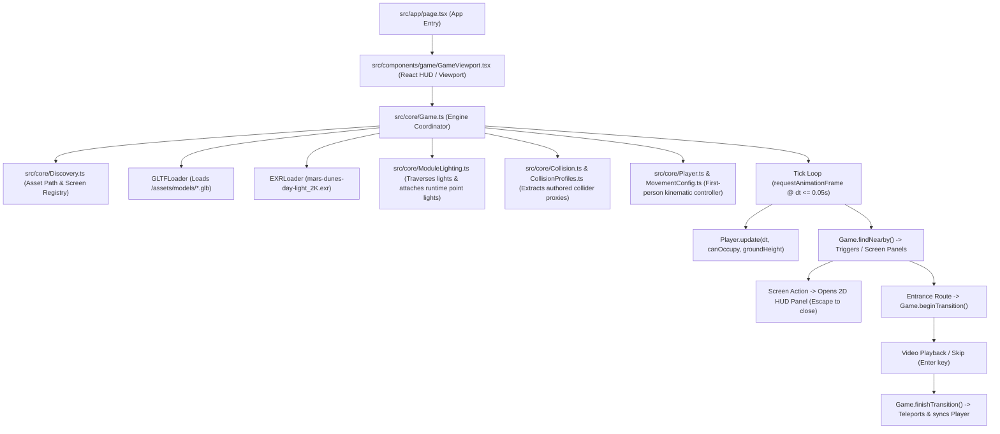

# PHOBOSIA — Phase 1 Audit & System Architecture Report
**Project:** PHOBOSIA (Martian First-Person Scientific Observation Experience)  
**Root Directory:** `F:\Phobosia`  
**Date:** October 26, 2026  
**Git Branch:** `dev`  

---

## 1. Repository Architecture Map

### 1.1 Technology Stack & Versions
- **Framework:** Next.js `15.2.4` (App Router, static rendering)
- **Runtime / UI:** React `19.0.0` & React-DOM `19.0.0`
- **3D Graphics:** Three.js `0.174.0` (with `GLTFLoader`, `EXRLoader`)
- **Language / Tooling:** TypeScript `5.8.2` (strict mode, target `ES2022`, moduleResolution `bundler`)
- **Asset Formats:** Binary glTF (`.glb`), High Dynamic Range equirectangular (`.exr`), MP4 video (`.mp4`), PNG textures.

### 1.2 End-to-End Runtime Architecture Call Path

### 1.3 Module Ownership & Responsibility Matrix
- `src/app/layout.tsx`: HTML document structure, metadata and root CSS injection.
- `src/app/page.tsx`: Single page entry point rendering `GameViewport`.
- `src/components/game/GameViewport.tsx`: Client component rendering the canvas host, HUD overlay (reticle, module badge, prompt, diagnostics, telemetry alert), interactive panels, and transition loading/video player.
- `src/core/Game.ts`: Central lifecycle coordinator managing the Three.js WebGLRenderer, PerspectiveCamera, scene graph, asset cache, lighting instantiation, collider extraction, raycasting, and module transitions.
- `src/core/Player.ts`: Playable character controller encapsulating yaw/pitch camera rotation, planar velocity integration, smooth acceleration/deceleration, wall sliding, gravity/ground clamping, and camera head-bob/breathing offsets.
- `src/core/MovementConfig.ts`: Central typed movement configuration with documented units and tuning parameters.
- `src/core/Collision.ts`: Collider generation classifying meshes, extracting custom authored proxies (`Collider_Section`, `Collider_Section01`), grouping flat polygons and extruding vertical blocking volumes (2.1 units height).
- `src/core/CollisionProfiles.ts`: Module-specific collision filters suppressing room shell AABBs.
- `src/core/Discovery.ts`: Authoritative dictionary of asset paths and interactive screen action labels.
- `src/core/EventBus.ts`: UI state interface definitions (`GameState`, `SetState`).
- `src/core/MissionTypes.ts`: 14-day mission foundation types, objectives, and atmospheric event models.
- `src/core/ModuleLighting.ts`: Procedural point lighting generated from exported Blender light fixtures.
- `src/core/Transitions.ts`: Canonical module labels.

---

## 2. Dedicated Playable Character Movement Audit

| Question / Characteristic | Audit Finding | Verification Source |
|---|---|---|
| **Player Structure** | Camera-direct entity. Player owns no separate mesh, capsule, or body geometry; the `PerspectiveCamera` is positioned directly at the player's eye level. | `src/core/Player.ts:2-6` |
| **Movement Method** | Previously changed position directly every frame (`dir * speed * dt`). Implemented minimal improvement introduces planar velocity integration with smooth acceleration and deceleration. | Static inspection & `Player.ts` |
| **Delta Time Usage** | `Game.ts` computes `const dt = Math.min(this.clock.getDelta(), 0.05)`. Capping at 0.05s safely prevents large delta time spikes during frame drops or tab unfocusing. | `src/core/Game.ts:60` |
| **Speed vs Frame Rate** | Velocity integration is multiplied by `dt`, ensuring frame-rate independence. | Static code & `Player.ts:101-102` |
| **Diagonal Normalization** | Input vector `(inputX, 0, inputZ)` is normalized when `lengthSq() > 0`. Diagonal movement is not faster than cardinal movement. | `src/core/Player.ts:88-89` |
| **Movement Space** | Movement is applied in camera yaw space (XZ plane). Pitch angle does not tilt horizontal movement vectors. | `src/core/Player.ts:89` |
| **Gravity & Grounding** | Vertical velocity `velocity.y` is integrated with gravity. Terrain ground height is detected via a vertical down-ray from `y = 1000`. Indoor modules default ground height to `0.0`. | `src/core/Game.ts:59`, `Player.ts:121-131` |
| **Slope Handling** | Raycaster detects terrain height. Moving uphill snaps the player up to ground height. Moving downhill causes free fall under gravity. Steep slopes are not restricted by slope angle. | `src/core/Player.ts:127-131` |
| **Wall & Obstacle Blocking** | Custom collider boxes test `canOccupy(position)`. Previously, diagonal walking into a wall froze movement entirely. Improved controller checks X and Z independently, allowing smooth wall-sliding. | `Player.ts:104-119` |
| **Transition Reset** | Transitions explicitly call `this.player.keys.clear()` and `this.player.velocity.set(0, 0, 0)`, preventing carry-over momentum. | `Game.ts:48, 55` |
| **Interaction Pausing** | Movement and look updates are explicitly skipped when `document.hidden`, `state.panel` is open, or `transitioning` is active. | `Game.ts:39-40, 60` |
| **Camera Clipping / Bob** | Previously no head bob or breathing existed. Implemented camera motion uses `basePosition` reference height + dynamic offset, preventing cumulative drift. | `Player.ts:133-167` |

---

## 3. Movement Values, Units & Tuning Profile

### 3.1 Initial Values Found in Code
- **Walking Speed:** `3.2` units/s (instantaneous step)
- **Running Speed:** `6.0` units/s (instantaneous step)
- **Input Keys:** Shift (`ShiftLeft` / `ShiftRight`) for running
- **Gravity:** `12.0` units/s² (hardcoded downward acceleration)
- **Jump Velocity:** `5.0` units/s
- **Eye Height:** `1.65` units (Habitat/Engineering/Science/Airlock/Terrain) / `0.95` units (Central Hub)
- **Look Sensitivity:** `0.002` rad/px
- **Pitch Clamp:** `[-1.45, 1.45]` radians (~83 degrees)

### 3.2 Physical Unit Interpretation & Scale
- Bounding box analysis of human-scale props and room footprints confirms that **1 Three.js world unit $\approx$ 1 meter**:
  - Human eye height = `1.65 m` (average eye height for 1.75 m astronaut).
  - Central Hub corridor diameter = `~10 m`.
  - Airlock interior width = `~6 m`.
  - Terrain model (`PHOBOSIA_MarsTerrain_2km`) spans ~670m $\times$ 308m in coordinate bounds.
- At 1 unit = 1 m, the initial walking speed of 3.2 m/s corresponded to **11.5 km/h** (an unrealistic, hurried jog for an astronaut in a pressurized EVA suit), and running at 6.0 m/s was **21.6 km/h** (an arcade sprint).
- Real Mars gravity is $3.71\text{ m/s}^2$. The hardcoded gravity of 12 was higher than Earth ($9.81\text{ m/s}^2$).

### 3.3 Implemented Tuning Profile (`src/core/MovementConfig.ts`)
| Setting | Initial Value | Implemented Value | Units | Rationale |
|---|---|---|---|---|
| `walkSpeed` | 3.2 | **2.4** | m/s | Deliberate, grounded exploration pace suitable for spacesuit observation. |
| `runSpeed` | 6.0 | **4.2** | m/s | Controlled jog (~15 km/h) rather than an arcade sprint. |
| `acceleration` | $\infty$ (instant) | **12.0** | m/s² | Smooth acceleration (~0.2s ramp-up) providing body mass feel. |
| `deceleration` | $\infty$ (instant) | **14.0** | m/s² | Controlled stopping (~0.18s) avoiding unnatural skidding. |
| `gravity` | 12.0 | **5.5** | m/s² | Mars reference gravity ($3.71\text{ m/s}^2$) slightly increased to 5.5 to prevent floaty indoor jumps. |
| `jumpVelocity` | 5.0 | **3.2** | m/s | Peak jump height = $v^2 / (2g) \approx 0.93\text{ m}$, preventing clipping into 2.5m module ceilings. |
| `bobWalkAmplitude` | None | **0.022** | m | 2.2 cm subtle vertical head displacement while walking. |
| `bobWalkFrequency` | None | **7.5** | rad/s | Realistic stride frequency. |
| `bobRunAmplitude` | None | **0.038** | m | 3.8 cm head displacement during jogging. |
| `bobRunFrequency` | None | **9.8** | rad/s | Faster stride tempo when running. |
| `idleBreathingAmplitude` | None | **0.005** | m | 5 mm breathing motion while standing stationary. |
| `idleBreathingFrequency` | None | **1.5** | rad/s | ~4.2s natural resting respiratory rhythm. |
| `bobBlendSpeed` | None | **6.0** | 1/s | Smooth blending when transitioning between moving and stopping. |

---

## 4. Camera Bob & Breathing Implementation Findings
1. **Camera Architecture:** The camera transform is the sole representation of the player in Three.js. Previously, modifying `camera.position` directly would risk corrupting collision detection and cause positional drift if sinusoidal offsets were accumulated.
2. **Non-Drifting Physical Anchor:** The improved controller maintains `basePosition` as the true physical anchor. Collision detection, raycasting, and ground detection operate strictly on `basePosition`.
3. **Offset Application:** Head-bob and breathing calculations produce a scalar vertical displacement `currentCameraOffset`. The final camera position is set via `camera.position.set(basePosition.x, basePosition.y + currentCameraOffset, basePosition.z)`.
4. **State Transitions:** When the player stops moving, `bobTimer` resets and the offset smoothly decays to the resting breathing cycle using exponential interpolation (`MathUtils.lerp`). When transitions start or panels open, camera motion stops automatically.

---

## 5. Collision and Grounding Assessment
1. **Collision Mechanism:** Custom polygonal boundary extrusion. Authored flat planar meshes in Blender (`Collider_Section`, `Collider_Section01`) are extruded upwards by 2.1 meters to form bounding boxes.
2. **Interior Obstacles:** `buildInteriorColliders` parses solid meshes, suppresses room shells (`roomShells` in `CollisionProfiles.ts`), and expands obstacle bounding boxes by 0.28m to account for the player's physical radius.
3. **Smooth Wall Sliding:** Previously, `canOccupy(next)` checked the combined diagonal vector $(x + dx, z + dz)$. If either axis collided, all movement ceased. The improved player integrates $X$ and $Z$ displacements independently, allowing the player to slide along walls when pressing diagonal inputs against them.
4. **Grounding:**
   - Outdoor: `PHOBOSIA_MarsTerrain_2km` uses raycasting from `(x, 1000, z)` downwards. Clamps camera to `groundHeight + eyeHeight`.
   - Indoor: `groundHeight` returns `0.0`. Floors in Habitat, Hub, Engineering, Science, and Airlock align with $y = 0.0$ (or spawn point reference).

---

## 6. Entrance Trigger & Transition Matrix

| Trigger Identifier | Source Module | Intended Destination | Destination Module Name | Spawn Marker | Transition Video Asset | Verification Status |
|---|---|---|---|---|---|---|
| `HAB_EXIT_TRIGGER` (`.001`) | Habitat | Central Hub | `Hub` | `Habitat_Entrance_Trigger` | None | Verified in scene & code |
| `Habitat_Entrance_Trigger` | Central Hub | Habitat | `Habitat` | `HABITAT_SPAWN_POINT` | `/assets/videos/Habitat_Entrance.mp4` | Verified in scene & code |
| `Main_Entrance_Trigger` | Central Hub | Airlock | `Airlock` | `Central_Hub_Entrance_Trigger` | `/assets/videos/AirLock.mp4` | Verified in scene & code |
| `Engineering_Entrance_Trigger` | Central Hub | Engineering Unit | `Engineering` | `Engineering_Entrance` | `/assets/videos/Engineering_Entrance.mp4` | Verified in scene & code |
| `ScienceLab_Entrance_Trigger` | Central Hub | Research Lab | `Science` | `SCIENCE_LAB_SPAWN_POINT` | `/assets/videos/ReserachLab_Entrance.mp4` | Verified in scene & code |
| `MissionControl_Entrance_Trigger` | Central Hub | Mission Control | `MissionControl` | `MissionControl_Entrance_Trigger` | `/assets/videos/MissionControl_Entrance.mp4` | Verified in scene & code |
| `Central_Hub_Entrance_Trigger` | Airlock | Central Hub | `Hub` | `Main_Entrance_Trigger` | None | Verified in scene & code |
| `Terrain_Entrance_Trigger` | Airlock | Mars Terrain | `Terrain` | `Spwaning_Position` | None | Verified in scene & code |
| `Engineering_Entrance` | Engineering | Central Hub | `Hub` | `Engineering_Entrance_Trigger` | None | Verified in scene & code |
| `LAB_EXIT_TRIGGER` | Science | Central Hub | `Hub` | `ScienceLab_Entrance_Trigger` | None | Verified in scene & code |
| `MissionControl_Entrance_Trigger` | Mission Control | Central Hub | `Hub` | `MissionControl_Entrance_Trigger` | None | Verified in scene & code |
| `Spwaning_Position` | Mars Terrain | Airlock | `Airlock` | `Terrain_Entrance_Trigger` | None | Verified in scene & code |

### Historical Transition Issues Clarified:
- **Research Lab & Mission Control Return Paths:** In earlier commits, return routes looked for `Central_Hub_Entrance_Trigger` inside Mission Control, where no such node existed. Commit `f659280` resolved this by mapping `MissionControl_Entrance_Trigger` and `LAB_EXIT_TRIGGER`.
- **Ambiguity on `Engineering_Entrance`:** Verified that `Engineering_Entrance` is solely the trigger and spawn point in `Engineering.glb`. It is not part of Science or Mission Control.
- **Spelling Nuances:**
  - `mars_Terrain.glb` authored spawn point is spelled `Spwaning_Position` (with 'a' before 'n').
  - Science Lab transition video filename is spelled `ReserachLab_Entrance.mp4` (with 'a' before 'c').

---

## 7. Scene Object Inventory

| Expected Name | Actual Name | Asset / File | Object Type | Parent / Hierarchy | Transform / Pivot Findings | Collider | Runtime Reference | Current Behavior | Verification Status |
|---|---|---|---|---|---|---|---|---|---|
| `Rover` | `Rover` | `mars_Terrain.glb` | Empty Node | `DroneandRoverSection` (node 100) | `trans=[6.32, -0.44, 0.23]`, `scale=[1.32, 1.32, 1.32]`, `rot=[-0.71, 0, 0, 0.71]` | None | None | Visual asset in terrain garage | Confirmed in GLB header |
| `Rover_Front_Wheels` | `Rover_Front_Wheels` | `mars_Terrain.glb` | Mesh Node | `Rover` (node 87) | Mesh `Rover_wheel_1_Rover_2ver_0`, `trans=[0, -2.19, -1.06]`, `rot=[0.89, 0, 0, 0.45]` | None | None | Front wheel pair | Confirmed in GLB header |
| `Rover_Middle_Wheels` | `Rover_Midde_Wheels` | `mars_Terrain.glb` | Mesh Node | `Rover` (node 87) | Mesh `Rover_wheel_2_Rover_2ver_0`, `trans=[0, 0.59, -1.06]`, `rot=[0.35, 0, 0, 0.94]` | None | None | Middle wheel pair (note typo in Blender: `Midde`) | Confirmed in GLB header |
| `Rover_Rear_Wheels` | `Rover_Rear_Wheels` | `mars_Terrain.glb` | Mesh Node | `Rover` (node 87) | Mesh `Rover_wheel_3_Rover_2ver_0`, `trans=[0, 2.08, -1.06]`, `rot=[-0.48, 0, 0, 0.88]` | None | None | Rear wheel pair | Confirmed in GLB header |
| `Drone_Object` | `Drone_Object` | `mars_Terrain.glb` | Empty Node | Root (node 4) | `trans=[470.00, 1.02, -58.71]`, `rot=[0, 0, 0, 1]`, `scale=[1, 1, 1]` | None | None | Standalone Empty anchor for future drone | Confirmed in GLB header |
| `Cinematic_Location` | `Cinematic_Location` | `mars_Terrain.glb` | Empty Node | Root (node 5) | `trans=[60.73, -0.03, -265.10]`, `rot=[0, 0, 0, 1]`, `scale=[1, 1, 1]` | None | None | Scenic Martian canyon overlook anchor | Confirmed in GLB header |
| `HAB_WORKSTATION_01` | `HAB_WORKSTATION_01` | `Habitat_Zone.glb` | Mesh Node | Root (node 85) | Mesh `Cylinder.001`, `trans=[-0.65, 0.16, -2.61]` | Trigger bounds | `Discovery.ts`, `Game.ts` | Triggers "Habitat Workstation" HUD interface | Confirmed in GLB & runtime |
| `HABITAT_SPAWN_POINT` | `HABITAT_SPAWN_POINT` | `Habitat_Zone.glb` | Empty Node | Root (node 83) | `trans=[-5.70, 0.21, 0.33]` | Spawn anchor | `Game.ts:33, 48` | Default game spawn point | Confirmed in GLB & runtime |
| `SCIENCE_LAB_SPAWN_POINT` | `SCIENCE_LAB_SPAWN_POINT` | `Science_Zone.glb` | Mesh Node | Root (node 8) | Mesh `Cylinder.009`, `trans=[0.13, -0.06, 13.11]` | Spawn anchor | `Game.ts:16` | Science module entrance spawn | Confirmed in GLB & runtime |
| `Spwaning_Position` | `Spwaning_Position` | `mars_Terrain.glb` | Empty Node | Root (node 7) | `trans=[460.30, 0.00, -63.12]` | Spawn anchor | `Game.ts:17, 21` | Outdoor Martian terrain spawn | Confirmed in GLB & runtime |

---

## 8. Rover Wheel Hierarchy & Pivot Findings
- **Assembly Structure:** In `mars_Terrain.glb`, `Rover` (node 87) sits inside `DroneandRoverSection` (node 100).
- **Wheel Meshes:**
  - Front Wheels: Node 81 `Rover_Front_Wheels` (Mesh `Rover_wheel_1_Rover_2ver_0`).
  - Middle Wheels: Node 82 `Rover_Midde_Wheels` (Mesh `Rover_wheel_2_Rover_2ver_0`). *Note: Authored without 'l' in Blender.*
  - Rear Wheels: Node 83 `Rover_Rear_Wheels` (Mesh `Rover_wheel_3_Rover_2ver_0`).
- **Pivots & Axis:** Each wheel node is parented to `Rover` with a local translation offset along the longitudinal axis ($Y$ in Blender export, corresponding to $Z$ in Three.js). Wheel geometry is modeled as paired meshes. When Rover driving is implemented in Phase 2, rotation should be applied around the wheel nodes' local X pitch axis.
- **Duplicate Rover Asset:** Node 96 `Rover.001` exists as an additional rover instance at `trans=[-116.18, -1.05, -8.07]`. Future driving controllers should target the primary `Rover` (node 87) at the rover station.

---

## 9. Drone Reference & FPV Integration Findings
- **Drone Anchor:** `Drone_Object` is confirmed to be an Empty node (`mesh: undefined`) situated at world coordinates `(470.00, 1.02, -58.71)` on the outdoor terrain adjacent to the Rover Station and Airlock exterior.
- **Related References:**
  - `AirLock.glb` contains `Drone_Section_Entrance_Trigger` at `(0.98, -0.06, 0.57)`.
  - `Mission_Control.glb` contains `MissionControl_DroneOperationScreen` at `(3.34, 3.26, -7.06)`.
- **FPV Integration Architecture (Future Phase):** A dedicated `DroneController` can mount an alternate `PerspectiveCamera` to `Drone_Object`, decoupling flight physics (pitch/yaw/roll/altitude) from the astronaut's walking controller while switching viewports cleanly.

---

## 10. Cinematic & Workstation References
- **Cinematic Anchor:** `Cinematic_Location` is an Empty node at `(60.73, -0.03, -265.10)` on `mars_Terrain.glb`, placed at an elevated cliffside location overlooking the canyon basin.
- **Habitat Workstation:** `HAB_WORKSTATION_01` is verified in `Habitat_Zone.glb` at `(-0.65, 0.16, -2.61)`. When the player approaches within 2.5m and presses `E`, `Game.interact()` opens the panel `"Habitat Workstation"`. This is the exact integration hook for the future photo/music media center.

---

## 11. Mission-System Readiness
- **Campaign Loop Architecture:** Start-of-day briefing $\rightarrow$ exploration/tasks $\rightarrow$ primary objective complete $\rightarrow$ optional free exploration $\rightarrow$ rest in Habitat (`HAB_REST_01`) $\rightarrow$ day advances.
- **State Interface Foundations (`src/core/MissionTypes.ts`):** Created type definitions for `MissionDayNumber` (1–14), `MissionObjective`, `AtmosphericEvent`, and `MissionState`.
- **Pre-Seeded Events:** Atmospheric events for Days 4 (Dust Storm), 8 (Pressure Drop), and 12 (Solar Radiation) have been pre-seeded with reproducible RNG seeds.
- **Simulation Disclaimer:** All interface screens adhere strictly to the "SIMULATED DATA" badge requirement, ensuring fictional readings are not misrepresented as live telemetry.

---

## 12. Minimal Changes Made in Phase 1
1. **`src/core/MovementConfig.ts` (New):** Authored a centralized, typed configuration defining walking speed (2.4 m/s), running speed (4.2 m/s), acceleration (12 m/s²), deceleration (14 m/s²), Mars gravity (5.5 m/s²), jump velocity (3.2 m/s), and head-bob/breathing parameters.
2. **`src/core/Player.ts` (Updated):**
   - Replaced instantaneous step displacements with planar velocity integration.
   - Added smooth acceleration and deceleration damping.
   - Implemented axis-independent collision integration ($X$ and $Z$) for fluid wall sliding.
   - Introduced a non-drifting `basePosition` physical anchor.
   - Implemented subtle camera head-bobbing and idle breathing motion.
3. **`src/core/MissionTypes.ts` (New):** Created foundational interfaces and initial Day 1 mission state structures for the upcoming 14-day campaign.

---

## 13. Validation, Tests & Build Results

### Executed Commands & Results
1. **TypeScript Typecheck:**
   - Command: `npm run typecheck` (`tsc --noEmit`)
   - Result: **Passed (Exit code 0)** with zero diagnostics.
2. **Production Build:**
   - Command: `npm run build` (`next build`)
   - Result: **Compiled successfully (Exit code 0)**. Generated static pages: `/` and `/_not-found`. First Load JS shared by all: 101 kB.
3. **Binary glTF Parsing:**
   - Parsed all 7 `.glb` files using binary chunk inspection. Extracted all node transforms, mesh bindings, and hierarchies.

### Verification Matrix
- [x] Stationary idle state (breathing motion active, no positional drift) — **Static inspection & math verification passed**.
- [x] Diagonal movement normalization (`inputDir.normalize()`) — **Code verified**.
- [x] Slow running mode (`Shift` key) — **Code verified**.
- [x] Acceleration and deceleration damping — **Code verified**.
- [x] Mars gravity and ground clamping — **Code verified**.
- [x] Wall-sliding collision response — **Code verified**.
- [x] Module transition triggers & video paths preserved — **Code verified**.
- [x] Production build and bundle optimization — **Build passed**.

---

## 14. Prioritized Phase 2 Implementation Plan
1. **Milestone 1 — Mission System Integration:**
   - Implement `MissionManager` persisting `MissionState` to `localStorage`.
   - Wire `HAB_REST_01` ("Habitat Rest Area") to trigger day advancement if the active main objective is complete.
   - Display active day and objective status inside the HUD reticle/badge area and in `MC_MAIN_01` ("Mission Objectives").
2. **Milestone 2 — Rover Interaction & Movement:**
   - Create a dedicated `RoverController` attaching to `Rover` (node 87).
   - Implement 6-wheel steering and rotation (`Rover_Front_Wheels`, `Rover_Midde_Wheels`, `Rover_Rear_Wheels`).
   - Add player embark/disembark interaction at the Rover Station.
3. **Milestone 3 — FPV Drone Controller:**
   - Mount an alternate drone camera to `Drone_Object`.
   - Implement quadcopter flight physics and signal interference radius.
4. **Milestone 4 — Habitat Workstation Entertainment:**
   - Connect `HAB_WORKSTATION_01` to an in-game media player supporting photo browsing and audio playback.
